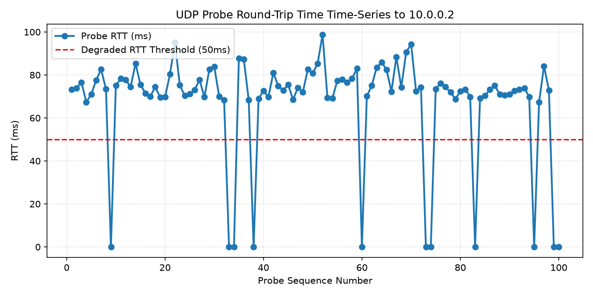

# SDN Network Diagnostic and Path Analysis Report

**Timestamp:** `2026-10-25T11:31:39Z`  
**Overall Path Health:** 🟨 **DEGRADED** (`DEGRADED_PATH`)  
**Endpoint Target:** `h1` -> `h2` (`10.0.0.2`)  
**Path Identification Method:** `FLOW_TABLE`  

---

## 1. Executive Summary & Diagnostic Notice

> **Primary Path Status:** `DEGRADED_PATH`  
> **Diagnostic Finding:** Path degradation detected: packet loss of 11.00% detected and mean RTT (75.80 ms) exceeds latency limit (50.00 ms).

### Active Forwarding Route
`h1 -> s1 -> s2 -> h2` (3 hops)

```
+---------------------------------------------------------------------------------+
|                       SDN TOPOLOGY AND FORWARDING PATH MAP                      |
+---------------------------------------------------------------------------------+
|                                                                                 |
|  ACTIVE FORWARDING ROUTE:                                                       |
|    [ h1 -> s1 -> s2 -> h2 ]                                                             |
|                                                                                 |
|  SUSPECTED BROKEN/DEGRADED LINKS:                                               |
|    s1 <---> s2
|                                                                                 |
|  RECOMMENDED FAILOVER BACKUP ROUTE:                                             |
|    [ h1 -> s1 -> s3 -> s2 -> h2 ]                                                             |
|                                                                                 |
+---------------------------------------------------------------------------------+
```

---

## 2. Quantitative Performance Telemetry

| Performance Metric | Measured Value | Nominal / Threshold Baseline | Health Evaluation |
|---|---|---|---|
| **Probes Sent / Received** | `100` sent / `89` received | `100` / `100` | Drops Detected |
| **Packet Loss Rate** | `11.00%` | `<= 0.0%` (Fail: `>= 50.0%`) | Threshold Exceeded |
| **Mean RTT** | `75.80 ms` | `<= 50.0 ms` | High Latency |
| **Minimum / Maximum RTT** | `67.33 ms` / `98.82 ms` | N/A | Range Spread |
| **Median RTT** | `73.93 ms` | N/A | Central Tendency |
| **95th Percentile RTT (p95)** | `88.09 ms` | N/A | Tail Latency Indicator |
| **Standard Deviation Jitter** | `6.68 ms` | Low variation | Sample Deviation |
| **RFC 3550 Inter-Arrival Jitter** | `4.91 ms` | Smoothed $J = J + (|D|-J)/16$ | Statistical Standard |


### RTT Time-Series Chart


---

## 3. Failure Localization & Evidence Sources

| Rank | Suspected Link | Combined Confidence | Localization Evidence Sources |
|---|---|---|---|
| 1 | `s1 <---> s2` | `60.0%` | Path-membership heuristic inference: active core link traversed during end-to-end degradation (not a physical measurement: OVS /stats/port drop counters were 0, kernel qdisc drops are not exposed via OpenFlow, and topology link state remained UP) |

---

## 4. Alternative Backup Routes & Failover Recommendation

| Rank | Route Status | Hop Count | Hop Penalty | Forwarding Path Route |
|---|---|---|---|---|
| 1 | `VIABLE_BACKUP` | 4 | +1 | `h1 -> s1 -> s3 -> s2 -> h2` |

### Actionable Rerouting Recommendation
> **Recommended Action:** Failover traffic to backup route **`h1 -> s1 -> s3 -> s2 -> h2`** (+1 extra hop penalty).  
> **Deployment Command:** `python3 sdnscope.py reroute --apply` (or `python3 reroute_helper.py --apply`)
